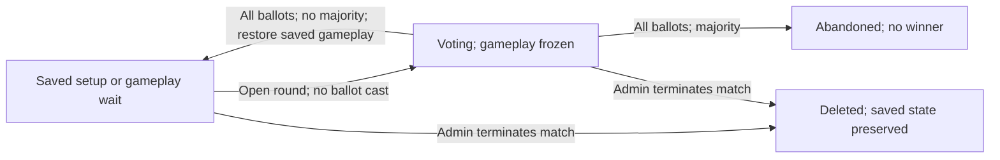

# Application Architecture

This document describes the current application architecture and the confirmed
backend expansion, marked as planned below. Game rules and mechanics belong in [GAME.md](GAME.md);
setup and usage instructions belong in [README.md](README.md). Where the reason for
a choice is not recorded, this document describes the choice without assigning a
motivation to it.

## Architectural goal

The backend is intended to be a presentation-layer-free game engine. It owns
game state and game behavior, and exposes them through web requests. Front ends
are separate clients of that API: a CLI, website, or local GUI should be able
to use the same backend without the engine knowing how the client presents the
game. HTTP controllers handle request and response translation; application
and game behavior belongs behind that boundary, without client-specific UI
logic.

## Service and API

The current implementation is a Go HTTP API with persistent drafting, automatic
turn execution, the completed opening/rumour/Spell catalogue, victory, and
administrative termination. Additional victory paths, Artifact research, voting,
and migrations remain future work. There is no client application in this repository. `main.go`
creates one Gin router; `internal/server` registers login, user, lobby, and
match routes using endpoint definitions from `api`, and startup registers Swagger.
The `api` package owns shared request, response, and nested public types and
depends only on the Go standard library. Private saved game state remains in
`game`; aliases there preserve its existing names for shared public types.
Controllers bind JSON requests, call application services, and write HTTP
responses. Swagger documentation is generated from comments in the Go code
using Swaggo and served by the application.

The current API has both resource routes using IDs and action routes such as
`POST /user/getbyemail`. The planned match API below settles its own ID-based
resource and command routes; broader conventions for existing routes remain
tracked in [TODO.md](TODO.md).

All API JSON models explicitly use lowercase field names, including `userid`
for lobby membership requests. Login returns `{"token":"…"}`, and lobby lookup
returns a `lobby` object with `id`, `name`, `owner`, `members`, `status`,
nullable `matchid`, and a `readiness` map from member user ID to boolean.
User lookup returns `{"user":{"id":"…","name":"…","email":"…"}}`.
Registration rejects
capitalized or mixed-case variants of its `email`, `name`, and `password`
request keys with 400, while other request decoding remains case-insensitive.
Broader registration validation and response changes remain planned separately.

## Application layers

The implemented user, authentication, lobby, and match features are organized into
packages. The usual request path is:

`HTTP route → controller → service facade → service → repository → SQLite`

Controllers own HTTP concerns. Services perform application operations and
checks, such as verifying lobby ownership and membership. Repositories issue
SQL through `database/sql`. Models used for API responses can differ from
stored models; for example, the public user response omits the password hash
and authentication token.

Service facades establish a database transaction around each operation they
expose. They pass the transaction to services and repositories, and the shared
transaction helpers commit on success or roll back on error. This allows an
operation such as creating a lobby and adding its owner as a member to happen
within one transaction. Dependencies are assembled explicitly in `main.go`.

## Persistence and identity

Application state is stored in a local SQLite database. The database path comes
from `GRIM_DB`, and the connection enables SQLite foreign key enforcement. The
base schema is defined in `sql/create-database.sql`; `sql/install-card-designs.sql`
adds the shared catalogue and its initial seed transactionally. There is no
general automatic migration system. Tables include users, lobbies, lobby
membership, matches, players, launch/command receipts, and `card_designs`. The creation script is an explicit database reset, never a
startup upgrade. The lifecycle schema requires a freshly created database;
existing databases are not automatically modified. The additive catalogue
installation preserves existing accounts, matches, and receipts.

Users and lobbies receive UUID string IDs generated by the application. Lobby
ownership is stored as an owner ID on the lobby, while membership is stored in
the `lobby_users` join table. The lobby creator is also inserted as a member.
Foreign keys connect lobbies, match participation, and memberships to users.
Matches and lobbies have nullable `deleted_at` timestamps: null means active,
and a UTC timestamp means deleted. Normal lookups and updates exclude deleted
records. Deleting an open lobby preserves its memberships; match termination
preserves its snapshot, metadata, participation, receipts, and closed-lobby link.
SQLite uses immediate transactions and a five-second busy timeout, serializing
competing operations before they read mutable lobby/match state.

## Automated participants

Lobby owners add and remove automated seats through `POST /lobby/:id/bot` and
`DELETE /lobby/:id/bot/:botid`. `lobby_bots` stores their stable `bot-<UUID>` IDs
and generated names, independently of user accounts. Humans remain in
`lobby_users`; capacity and public discovery count both tables. Only humans
have readiness and can own a lobby. Automated seats are always ready, and
changing either roster clears human readiness. Open lobbies remain public.

Launch fixes the combined roster in the snapshot and copies names into the
optional `bots` map. Match `players` rows remain human-only and continue to
authorize requests. Existing schema-3 snapshots without `bots` remain valid.
Fresh database setup includes `lobby_bots`; existing deployments explicitly run
`sql/install-lobby-bots.sql` before restarting. Startup checks this storage and
never installs it automatically.

The `bot` package owns deterministic draft and gameplay strategy, receiving only
an opponent's participant projection, draft offers, and pinned catalogue. It
returns ranked candidate commands; the match service validates them with the
same immutable `Choose`/`Apply` engine used for humans. Failed candidates cannot
advance the saved random generator. Match orchestration handles scheduling and
storage, with no strategy in the engine, controllers, or repositories.

After launch or a new human command, the service runs automated inputs until a
human decision boundary or victory. Setup completes all automated drafts before
returning. Human transitions, automated transitions, final snapshot, and the
human response receipt commit together. Each accepted transition increments the
revision, so clients must use the returned revision rather than add one. Exact
retries replay before running automation, and reads are side-effect free.
No background worker or additional startup recovery is necessary. A per-turn
proactive-input budget and a per-request transition guard bound execution;
unexpected failures roll back and log an operator diagnostic. Automated play
can finish the match after all humans have been eliminated.

## Authentication and runtime

User creation hashes passwords with scrypt, using the normalized email address
as the salt. Login checks that hash, generates a random token, and stores the
token on the user record. Protected routes read the token from the
`Authorization` header, look up the associated user, and place that user in the
request context for the controller. The current code expects the token value
directly in the header. It does not parse a `Bearer` scheme or implement token
expiry. Token verification does not log authentication tokens.

The server reads `GRIM_DB` and `GRIM_SSL` from environment variables. It listens
on `localhost:8080` using TLS certificates at `GRIM_SSL/grim.crt` and
`GRIM_SSL/grim.key`. Some README examples use `http://`; the current startup
code uses TLS. The repository provides SQL scripts for initial database setup
and test data. HTTP/SQLite lifecycle tests exercise production route wiring,
transaction rollback, concurrent requests, restart recovery, and authorization.

## Implemented lobby and match lifecycle

Full lobby reads are member-only. All lobbies are public. Authenticated users
browse `GET /lobbies/public` and join themselves with `POST /lobby/:id/join`.
The authenticated owner also controls additions, removals, updates, and transfers;
a transfer target must already be a member.
Ordinary members leave with bodyless `DELETE /lobby/:id/leave`, which infers
identity from authentication and calls the same transactional removal service.
It returns 200 without a body and standard JSON errors. The explicit-target
`DELETE /lobby/:id/user/:user_id` route retains its existing authorization.
Both routes keep the lobby ID, supporting future multiple-lobby membership. The owner
must transfer ownership or delete the open lobby instead of removing themselves.
Changing the roster clears every member's readiness; ownership transfer alone
does not. Each member controls only their own readiness.

Public discovery returns `{"lobbies":[...]}` with only `id`, `name`, `owner`,
and `membercount`, ordered by ID without pagination. It excludes deleted,
closed, and full lobbies, returns an empty array when none are available, and
is accessible even to users already in an open lobby. `GET /lobbies` retains
its existing membership-list contract.

Capacity is four members. Creation, self-join, and owner additions enforce
at most one nondeleted open lobby per user. Creation includes its owner as an
unready member. Self-join takes no body and returns `200` with `lobby`;
rejoining an open lobby already joined returns the current view without
clearing readiness, even when full. Other membership additions clear all
readiness. Capacity and membership checks run with insertion and readiness
reset in the same immediate transaction, serializing concurrent changes.
Leaving, deletion, or launch releases the open-membership restriction.
Historical memberships remain preserved; conflicting legacy memberships are
not automatically repaired. This feature requires no schema change.

| Operation | Endpoint | Request | Success |
| --- | --- | --- | --- |
| Browse public lobbies | `GET /lobbies/public` | No body | 200 with `lobbies` summaries |
| Join public lobby | `POST /lobby/:id/join` | No body | 200 with `lobby` |
| Leave as authenticated user | `DELETE /lobby/:id/leave` | No body | 200, no body |
| Remove explicit user | `DELETE /lobby/:id/user/:user_id` | No body | 200, no body |
| Set own readiness | `PUT /lobby/:id/ready` | `{"ready":true}` or `{"ready":false}` | 200 with `lobby` |
| Launch once | `POST /lobby/:id/launch` | `{"requestid":"<UUID>"}` | 201 with `match` |
| Get participant view | `GET /match/:id` | No body | 200 with `match` |
| Get current draft options | `GET /match/:id/draft` | No body | 200 with `draft`, `cards`, `revision`, `status` |
| Choose opening card | `POST /match/:id/draft` | Request ID, expected revision, type, card ID | 200 with `draft`, `cards`, `revision`, `status` |
| Submit action | `POST /match/:id/actions/<operation>` | Operation-specific request, request ID, expected revision | 200 with `match` |
| Answer required choice | `POST /match/:id/choices/:choiceid/<operation>` | Operation-specific request, request ID, expected revision | 200 with `match` |
| Submit Priority response | `POST /match/:id/reactions/<operation>` | Reaction card play, defence, or pass; request ID, expected revision | 200 with `match` |
| Get pinned catalogue | `GET /match/:id/catalogue` | No body | 200 with `catalogue` |
| Administrative termination | `POST /admin/match/:id/end` | No body or expected revision | 204, no body |

Launch requires the owner to be a member of an open lobby with two to four
members, all ready. In one transaction it stores match identity/membership,
schema-version-3 setup state with empty Ring, private initial random state,
pinned opening versions, the closed lobby's match link, and the accepted launch
receipt. Database uniqueness enforces one match
per source lobby. Closed lobbies remain member-readable and permanently reject
updates, deletion, roster changes, and readiness changes, including after the
match ends.

The CLI and interactive wrapper send the lobby UUID as the launch `requestid`.
Retries therefore use a deterministic ID without extra client state; the launch
API continues accepting canonical UUIDs with the same receipt behavior.

Receipts are scoped to lobby, authenticated actor, and request ID. Authorization
is checked before receipt access. An identical accepted retry returns its
original 201 and view while the match remains active; clients query the
match for current state. After soft deletion, an accepted launch retry returns
404 instead of the saved view. A new request ID on a closed lobby conflicts. A request
ID recorded for a different operation conflicts. Failed operations/commits leave
no partial match, closure, receipt, or changed saved random state.

The `game` package owns HTTP/SQL-independent drafting, gameplay transitions,
definition validation, and participant-specific projections. The `catalogue`
package loads definitions from SQLite and depends only on shared API types. The `match`
package owns application services and SQLite persistence; lobby launch calls it
within the lobby transaction. Launch sorts members by user ID and seeds Go's
`math/rand/v2` ChaCha8 with 32 bytes from `crypto/rand`, without consuming random
draws. Draft completion first shuffles the Ring, then each deck in sorted
participant order. Initial seed, `chacha8-v1` generator identifier, and binary
generator state remain private. Rules remain `playable-v1`; catalogue versions
are loaded from the database and pinned independently for each match.
Unsupported schemas or pinned versions return `unsupported_state` without
rewriting state. Snapshot identity/status/revision/outcome must agree with
searchable match metadata when loading. Fresh matches are required for the
playable release; accounts and lobbies need no table changes. There is no automatic snapshot migration or database reset.

The participant view contains `id`, `name`, `lobbyid`, `status`, `revision`,
`participants`, `ring`, nullable `outcome`, pinned versions, `wizards`, `turn`,
and the caller's private `you` object, without draft offers. Participants and Ring entries
are human user IDs or automated participant IDs. Launch inherits the lobby name
and starts at `status:"setup"`, revision 0 plus three picks per automated
participant, and null outcome. Views never include the private snapshot, seed,
generator state, or administrator flag. Administrators have no extra lookup
access unless they are participants.

### Implemented drafting and game start

Each wizard independently locks a Chantry, victory-path card, then an offered
Minion using explicit `choose_chantry`, `choose_victory_path`, and `choose_minion`
types. The envelope contains canonical UUID `requestid`, required nonnegative
`expectedrevision`, `type`, and design `cardid`; unknown fields and trailing JSON
are rejected. `GET /match/:id/draft` reveals full card designs for only the
caller's current step, without changing state or revision. `POST` to the same
path locks a choice and returns the next step's options. Both return
`draft`, `cards`, `revision`, and match `status`. Completed drafts return
`step:"complete"` and `cards:[]`, while other players finish or after game start.
Copies are unlimited, and selections cannot be revised. The caller sees their own draft; rivals see
only completion flags. There are no deadlines, automatic picks for humans, or readiness
vote after drafting.

Command receipts are scoped to match, actor, and request ID. Membership and
deletion are checked before receipt lookup; equivalent typed input replays its
original draft progress and options before revision or snapshot validation.
Receipts continue storing participant views; draft responses are projected
from those recorded views instead of current state. Legacy `draftoffers`
fields are ignored on receipt loading, including launch retries. Receipt storage requires no migration; new gameplay requires a supported
snapshot version. Changed input conflicts.
New commands require the current global revision. Every accepted command saves
its new snapshot, metadata, incremented revision, and response receipt in one
transaction. Immediate SQLite transactions serialize writers; the snapshot
update also checks the expected revision. Invalid or failed commands leave no
receipt, choice, or advanced random state. Stable added errors are
`stale_revision` (409), `draft_sequence` (409), `draft_closed` (409), and
`invalid_choice` (400).

The final choice automatically creates random seating, eleven instances per
wizard (one Chantry in play plus ten shuffled deck cards), 3 Integrity, five-card
hands, elemental Affinity, and zero progress on all five victory paths. Instance
IDs derive from match, owner, and a pre-shuffle construction index; they remain
stable and never encode draw order. The first Ring wizard starts turn 1 at
`start`/`recovery`; the final draft transaction automatically advances through Income, rumour drawing, and other
automatic steps to the first required input. No separate start request is needed.

The catalogue contains 98 designs (31 original, two ephemeral resources,
32 Spells, 20 rumours, and 13 rewards), with typed
effect identifiers and structured printed properties. Four victory definitions
and Research Artifact are explicit inert placeholders; only Subjugate Rival is
offered for victory-path drafting. Catalogue access applies the same participant,
deletion, metadata, and version checks as lookup. Definitions remain available
before and during drafting, but the catalogue does not identify draft offers.
Only the dedicated draft endpoint reveals the current offer list. Public playing views contain
Integrity, Affinities, victory progress, in-play cards, ordered discards, and
pile counts. The caller also sees their hand and draw-pile contents sorted by
instance ID. Draw order and other wizards' remaining selections stay private.

Administrative termination checks the current `users.admin` flag inside its
transaction; the administrator need not participate. Any existing match can
be soft-deleted, including a finished match or an unsupported saved snapshot.
Termination sets `deleted_at` with SQLite `datetime('now')`, without decoding
or changing status, outcome, revision, or saved state. It returns 204 after
commit. Repeated termination succeeds without writes or changing the timestamp;
an unknown match returns 404. Normal match lookup returns 404 after deletion.
Membership, receipts, and the visible closed lobby remain intact.
Open-lobby deletion also sets `deleted_at`, retaining its existing owner-only
authorization and 200 response; further lobby operations return 404. No pending
effects are resolved.
The operator grants/revokes administrator status through direct database
updates; ordinary account creation/updates cannot grant or overwrite it.

All protected routes use the same authentication handler, returning JSON errors
for missing/invalid tokens and unexpected authentication failures. Lifecycle
endpoints also use JSON errors
`{"error":{"code":"…","message":"…"}}`. Invalid input is 400, missing/invalid
authentication 401, permission denial 403, missing resources 404, lifecycle
conflicts or unsupported saved schemas 409, and unexpected failures 500 without
internal details. Launch/readiness JSON names are lowercase, with existing
case-insensitive decoding. Readiness requires a present boolean, including
false; launch requires a canonical UUID request ID. Stable codes include
`invalid_request`, `unauthorized`, `forbidden`, `not_found`, `lobby_not_ready`,
`invalid_roster_size`, `lobby_closed`, `lobby_full`, `already_in_open_lobby`,
`request_id_conflict`,
`unsupported_state`, and `internal_error`. Existing
lobby operations retain their older controller success/error formats where applicable;
new owner-departure and transfer checks use `owner_must_transfer` (409) and
`invalid_owner` (400).

### Implemented playable engine

`game.State.Apply` applies typed gameplay commands to an isolated state copy;
rejection leaves the original snapshot and generator unchanged. The engine
advances through automatic steps until it reaches ordinary action input,
Priority, a required choice, or match end. Card definitions are loaded from one
wide `card_designs` table: ordinary properties and individual stats have columns;
list properties use JSON arrays. Definitions are validated and injected as an
immutable runtime dependency. State cloning retains that dependency, while
snapshots retain only their existing design/version references. There is no
scripting interpreter or hard-coded catalogue fallback. Handler implementations
and opening draft-selection rules remain Go code.

Rows are keyed by catalogue version and design ID, with consecutive ordering
preserved for reproducible random selections. A version becomes immutable once
any saved match references it; triggers guard inserts, updates, and deletes even
for ended or soft-deleted matches. New content uses a new version selected for
new matches with `GRIM_CATALOGUE_VERSION` (default `playable-v1`). The application
loads each pinned version within the operation's transaction. Startup validates
the configured version without changing the database. Draft receipt projections
use their recorded version; accepted gameplay receipts replay without loading
the current catalogue. See [ADR 0005](docs/adr/0005-database-card-catalogue.md).

The saved snapshot includes local owner-turn counters, resources, deployment
and recovery state, rumours, reserved Investigate draws, duration anchors,
deferred expiry effects, elimination, winners, phase-effect choices, and an
exchange with fixed participants, commitments, Stack, Priority, and pass count.
Resolutions can pause with explicit stages and persisted choices. No other
command interleaves while a resolution choice is pending. Random outcomes and
choices are committed with their generating command, never regenerated by reads.

Each gameplay operation has its own request type in `api`, route definition,
escaped path helper, controller binding, and Swagger schema. Actions use
`POST /match/:id/actions/<operation>`; required choices use
`POST /match/:id/choices/:choiceid/<operation>`; Priority responses use
`POST /match/:id/reactions/<operation>`. All accept `requestid` and
`expectedrevision`, reject unknown fields and trailing JSON, and return the
actor's `api.MatchResponse`. Gameplay bodies have no `type`, `mode`, or `choiceid`.
The complete route/field contract is in [README.md](README.md#play-through-turns-and-victory).

Narrow requests translate into `game.Command`, the engine's internal input
representation. Route intent requires the selected card or pending choice to
support the requested operation. Attack, Research, and standalone Focus healing
have dedicated actions. Full Moon's hunt has its own choice operation; ordinary
effect resolution cannot carry hunt commitments. Required choices pause Priority.
Authentication, membership, soft deletion, revision checks, engine execution,
receipts, and snapshot/metadata writes share one transactional pipeline.

Receipt identity records the precise operation, path-bound choice ID, revision,
and normalized input. Request IDs remain shared across routes. Identical accepted
retries replay before current revision, snapshot decoding, or live timing checks,
including after choices disappear, Priority changes, restart, or victory. Changed
operation, choice, revision, or payload conflicts. Historical broad-route receipts
remain untouched and reserve their UUIDs; new routes never reinterpret them.
The broad `/commands` and `/reactions` routes and their public request types are
removed. This requires no table or snapshot migration or rules/catalogue bump.
Deploy backend and CLI together, rebuild the CLI beside the Bash wrapper, and
restart wrapper sessions. Unsupported old snapshots remain unsupported for new
transitions and normal reads.

Views expose the public exchange, resolving effect, Priority, resources,
commitments, modifiers, and required-choice context. Private discard/scrying
options and inspected cards appear only for the deciding wizard. Other hands,
draw contents, generator state, and seeds remain private. Draw order is exposed
only by the printed private inspection effect. Clients derive legal actions;
there is no public history, action enumeration, or push delivery.

The current catalogue implements every completed opening card, rumour and
reward, and all 32 Spells. Research Artifact remains inert in the starting deck;
unfinished victory cards are retained definitions but cannot be drafted.
Domination-only drafting ensures each wizard can acquire the designed Attack
permission. Defensive commitments require ready Might Minions. Immunity lasts
through the victim's next own turn, including kneeling, independently of Ring
changes. Other mechanics follow GAME.md and the rumour catalogue.

New matches pin schema 3, `playable-v1` rules, and the configured catalogue version. Deployment does not
rewrite old matches or recreate tables. Unsupported opening-v1 matches can
still be administratively deleted. Terminal views retain nullable string
`outcome` (`victory` or `draw`) and add `winners` containing user IDs. Five-step
victory is checked after its complete awarding resolution/submission; survivor
victory waits for exchange completion. Further gameplay is rejected.

Post-commit debug diagnostics use Go's structured logger for command identity,
actor, revision, versions, selections, generated random decisions, and pending
choice context. Failed transactions emit no accepted-command entry. These
operator diagnostics are separate from participant projections and contain no
authentication tokens or credentials. The private seed remains in the snapshot;
there is no replay store.

Player abandonment votes, ordered migrations, saved-state upgrades, remaining
victory paths, Artifact research, and new card designs remain deferred.

## Remaining technical work

The planned match backend below settles its permissions, migration approach,
and game API. Database backup and caching policies, broader conventions for
existing routes, and logging implementation remain backlog items in
[TODO.md](TODO.md).

## Planned match backend

This confirmed contract describes both the implemented engine and deferred
extensions. The playable release above delivers complete games using the
completed designs and Domination-only drafting. Voting, migrations, and further
content below are future work; they do not gate this narrower playable release.

### Agreed scope

- A complete game with a small card catalogue is the first milestone.
- Matches are intended to finish in a single sitting, but response windows
  have no deadline. Players pass explicitly; elapsed time never implies a pass.
- The initial audience is a private playtest group of human players on one
  server, supporting multiple independent matches.
- Bots and spectators are deferred from this milestone.
- Matches support two through four players initially, including the distinct
  two-player rules and multiplayer Ring movement.
- Existing provisional game rules in [GAME.md](GAME.md) remain the baseline;
  content and rule gaps required by the selected catalogue must be settled.

### Lobby and match lifecycle

- A lobby exists only to set up and launch one match. It closes when the game
  begins; it is not reused for another match.
- Every participant must explicitly mark themselves ready. A roster change
  clears readiness for all participants.
- Only the lobby owner can launch, with two to four ready participants.
  Launch closes the lobby and creates a match in setup, including drafting.
- The server randomly orders participants into the initial Ring after every
  wizard completes drafting and records that order. Seating is unassigned
  during drafting; the first wizard in the Ring then takes the first turn.
  This planned behavior replaces the implemented launch-time seating.
- Drafting follows the agreed provisional rules in
  [GAME.md](GAME.md#drafting): independent, private, irreversible selections,
  followed by automatic setup completion without another readiness vote.
- All lobbies are public with capacity four. Authenticated users can discover
  available lobby summaries and join themselves; owners can also add members.
  Each user may belong to only one nondeleted open lobby. Each participant
  controls their own readiness; the former owner has no special gameplay
  authority after launch.
- Match views and commands are available only to authenticated participants.
- Members may leave before launch, clearing readiness. The owner must
  transfer ownership to another member or delete the open lobby before leaving.
- Full lobby details are restricted to members. After launch, retain a closed lobby
  record pointing to its match and reject roster changes. Disconnecting
  preserves match participation; ending the match follows its vote/admin policy.

### Server state and client interaction

- The server owns and stores all authoritative match state and supports
  resumption, including unfinished exchanges and pending player choices.
- A required choice, such as selecting a card to discard, is recorded as an
  explicit waiting state. The match advances only after the client submits a
  valid choice from the required player.
- Response windows have no automatic timeout or pass.
- The initial API uses HTTP commands and polling for current player views.
  Views respect hidden information and identify who must act next; push
  delivery is deferred.
- Ordinary actions use `POST /match/:id/actions/<operation>`, required-choice
  answers use `POST /match/:id/choices/:choiceid/<operation>`, and Priority
  responses use `POST /match/:id/reactions/<operation>`. Every route has a typed
  payload, request ID, and expected revision. `GET /match/:id` returns the requesting
  participant's view. Readiness and launch remain lobby operations; launch
  must also be atomic and safe to retry. The implemented opening choices use
  `POST /match/:id/draft`; the former draft-only `/commands` route is removed.
- Voting uses separate endpoints and payloads: `POST /match/:id/votes` opens
  a round without casting a ballot; `POST /match/:id/votes/:roundId/ballots`
  submits a yes/no ballot. Opening a round and voting are separate requests,
  including for the initiator. Voting payloads do not use the gameplay command
  envelope, but retain request-ID, revision, authentication, and atomicity checks.
- Clients know the game rules and derive available actions, payments, and
  targets from the supplied state. The server validates every command and
  provides all randomization; it does not need to enumerate legal actions
  for the client.
- Match views include rules/catalogue versions, phase, Priority, public state,
  visible cards, and pile counts. A Required choice identifies its ID, deciding
  player, type, source, and necessary context, including persisted server-
  generated Research offers. Clients derive valid selections from that state
  and their rule knowledge.
- `GET /match/:id/catalogue` exposes the match's pinned card definitions to
  participants. Clients must support the match's stated rules version.
- The authoritative state is a versioned match document in SQLite, replaced
  transactionally after each accepted command. Membership and searchable
  metadata use ordinary tables. Schema version and match revision serve
  different purposes: decoding saved state and detecting stale commands.
- Each command supplies a unique request ID and its expected match revision.
  Retrying the same command returns its recorded outcome without repeating
  the action; conflicting commands are rejected so clients can refresh.
- The resulting state and command outcome are stored in one transaction.
  See [the persistence ADR](docs/adr/0001-match-snapshots-and-command-receipts.md).
- A Required choice may pause one logically uninterrupted Resolution across
  requests; it does not open a response window or allow other gameplay to
  interleave. Continuations are explicit saved data, rather than suspended
  functions or live connections.

### Engine and card definitions

- Implement game rules as a Go state machine independent of HTTP and SQLite.
  The application service authenticates requests, loads state, invokes the
  engine, and saves accepted transitions and their command outcomes.
- The engine performs automatic steps until it reaches a response window,
  Required choice, or match end.
- Store the server's private random-generator state with match state, and
  commit random outcomes with the command producing them. Randomness must
  be reproducible within a match and remain consistent across restarts;
  random-generator state and the initial seed are excluded from player views.
- Retain the initial seed and use diagnostic logs to reconstruct game flow
  when debugging. Do not build a complete replay store or replay API; ordinary
  operation and restart recovery use the authoritative snapshot.
- Diagnostic logs include accepted command inputs and choices, match ID,
  authenticated actor, revision, pinned versions, and random outcomes. They
  are operator-accessible and separate from player views; credentials and
  tokens are never logged.
- Do not provide a stored public player history or a player-history endpoint.
- Card designs are stored in one versioned database table with structured stats
  and references to typed Go effect handlers. The application loads and validates
  definitions, then injects them into the independent engine. Card instances have separate identities, ownership, locations,
  and changing state. No arbitrary card scripting language is required.
- Each match pins its catalogue and rules versions. Deployments must preserve
  behavior needed by unfinished matches or supply an explicit migration;
  loading an old match must not silently adopt changed rules or card values.
- See [the engine ADR](docs/adr/0002-independent-engine-and-typed-card-effects.md)
  and [the compatibility ADR](docs/adr/0003-pin-match-rules-and-catalogue.md).

### Administrative endings

- A server administrator has an authenticated `POST /admin/match/:id/end`
  endpoint to soft-delete a match while preserving its state, with an additional
  administrator authorization check.
- Add an `admin` column to the users table; administrator status is stored
  there rather than in a configured allowlist. Use `admin NOT NULL DEFAULT 0`.
- The server operator grants and revokes admin status through database updates
  initially; no admin-management API is required. Exclude admin status from
  public writable fields, preserve it in ordinary updates, and check the
  current stored flag on every admin request so revocation is immediate.
- Otherwise, ending the match requires a simple majority of remaining,
  non-eliminated players; during setup, all participants are eligible.
- Ballots cannot be changed. An open vote freezes all ordinary actions,
  Reactions, and other gameplay progression until every eligible player has
  submitted a ballot. There is no early conclusion when a majority appears.
- Voting rounds have no deadline. A round may begin while the game is waiting
  for input, regardless of Priority. Preserve its suspended gameplay state.
- Once all eligible ballots are submitted, a strict majority approves
  abandonment; a tie fails. An approved completed vote ends the match without
  awarding victory or resolving pending effects. An admin command soft-deletes
  the match without changing its saved result or resolving pending effects.
- A failed completed vote resumes the suspended gameplay state. A new vote
  can start only after the preceding vote concludes, with fresh ballots.
- A failed vote is closed; its support never carries forward or becomes
  sufficient automatically after elimination. A fresh abandonment vote is
  required.
- Eliminated players' ballots are invalidated and they do not participate
  further. Ordinary gameplay cannot cause elimination during a frozen vote.
- Opening a round never casts a ballot. Every eligible player submits a
  separate ballot payload through the ballot endpoint.
- Ballots are open but voter identities are not disclosed. Public views show
  aggregate yes/no counts, electorate size, and votes outstanding, without
  identifying who voted or who has not voted. The requesting player may see
  their own ballot status; internal actor-to-ballot associations stay private.
- The current round and its concluded outcome are part of current match state;
  a new round clears all prior support. There is no public voting history.
- Disconnecting alone does not end a match or produce automatic gameplay.
- Administrative authorization is distinct from lobby ownership and ordinary
  participant authentication; the lifecycle implementation stores its flag in
  the users table.

### Storage upgrades

- Introduce ordered incremental database migrations preserving existing
  accounts and lobbies, and explicit saved-document schema upgrades.
- An unsupported saved version produces a clear error without modifying the
  saved state. Deployments must account for pinned versions needed by
  unfinished matches; rules and catalogue changes cannot silently reinterpret
  those matches.

### Player information

The visibility clarification is recorded in [GAME.md](GAME.md).

| Information | Owning wizard | Other wizards |
| --- | --- | --- |
| Hand contents | Visible | Hidden |
| Draw-pile contents | Visible without order | Hidden |
| Draw-pile order | Hidden | Hidden |
| Discard-pile contents and order | Visible | Visible |
| Table state and revealed declarations | Visible | Visible |

Player views must apply these rules independently of authoritative storage.

### Separate game-content prerequisites

The playable release is accepted with the completed designs and Domination-only
drafting. Expanding beyond it requires separate card design; the backend
contract does not settle unfinished card texts.

- Finish the other four victory paths beyond their inert drafting
  placeholders, including the required victory challenges and ranks.
- Design Artifact creation pools and Research Artifact rules. Spell pools and
  Research Spell are implemented.
- Revisit immunity and defence only through explicit future rules changes;
  their playable-release rules are settled above.
- Playtest the implemented draft procedure and starting offers.

### Boundaries and stored state

- A `game` package owns rules, card designs and instances, state transitions,
  effect handlers, and viewer-specific projections. It has no HTTP or SQL
  dependencies.
- A `match` application package follows the existing controller/service/
  repository pattern for authentication, transactions, command receipts,
  participant views, catalogue access, and administrative termination.
- Extend `lobby` for member access, voluntary departure, controlled ownership
  transfer, readiness, and one-time launch. Fix the existing UpdateLobby
  authorization gap: the authenticated owner must authorize updates and
  ownership transfers; a body-supplied owner ID never establishes authority.
- Store match identity, membership, lifecycle/search metadata, the versioned
  snapshot, and command receipts in SQLite. Launch stores the closed-lobby link,
  participants, initial snapshot and private random state, and launch receipt
  in one transaction. The planned draft-completion transition records random
  seating, starting cards, and initial hands together.

The snapshot contains:

| Area | Stored information |
| --- | --- |
| Identity and compatibility | Match ID, schema version, rules version, catalogue version, revision, setup/playing/finished status |
| Players and Ring | Fixed user-to-wizard association, Ring order, elimination status, Integrity, progress on each victory path |
| Cards and zones | Instance/design IDs, ownership, ordered draw and discard piles, hands, assets, rumours, reserved Investigate draws, exhaustion and eligibility |
| Turn and effects | Active wizard, phase and step, turn counters, income/resources, used Attack, duration anchors, deferred expiry effects |
| Exchange | Original participants, surviving eligible players, Stack, commitments, payments, targets, Priority, consecutive passes, pending mandatory triggers |
| Required choices | Choice ID, deciding player, type, source/context, random offers, explicit continuation and instruction position |
| Randomness | Private initial seed and current generator state, interpreted with pinned random behavior |
| Administrative control | Current vote round and ballots, suspended gameplay state, final victory/draw/abandonment outcome |

The engine stops for ordinary player input as well as Priority, a Required
choice, a vote, or match end. A paused resolution cannot create an opportunity
for unrelated gameplay; a failed abandonment vote returns to that same pause.

Receipts are scoped to the match, authenticated actor, and request ID and
identify the submitted command. An identical accepted retry is recognized before
checking the current revision. Reusing an ID for different input is rejected.
Authorization is checked on every request. Invalid commands and transaction
failures leave authoritative state, revision, and random state unchanged.

### Delivery sequence

The implemented lifecycle and drafting slices update the database creation
script directly, without ordered migrations or automatic upgrades. They provide
launch, opening drafting, atomic game start, version pinning, participant
projections, command receipts, administrative termination, and complete gameplay
with the completed catalogue. Player abandonment voting, migrations, and
additional card systems remain subsequent work. The numbered sequence below
records the broader design, including those deferred extensions.

1. Add incremental migrations, admin storage/checks, lobby authorization,
   readiness/departure/transfer, match storage, and transactional one-time launch.
2. Build the independent state machine, card instances/zones, saved choices,
   reproducible random state, player projections, and command/retry protocol.
   Development fixtures may exercise these components without defining final
   card content or claiming that a complete game is playable.
3. Implement the documented phases, resources, Challenges, response exchanges,
   effect continuations, Ring movement, elimination, and victory checkpoints;
   gate unfinished mechanics on their separate game-design decisions.
4. Complete the separate catalogue/rules prerequisites and integrate their
   definitions and effect handlers beyond the implemented opening catalogue.
5. Verify complete two-, three-, and four-player matches, restart recovery,
   voting/admin endings, version compatibility, and the presentation-independent
   API. Client applications remain separate work.

### Acceptance scenarios

- Launch requires the owner, two to four members, and current readiness from
  each member. Roster changes clear readiness; retries create only one match.
- Every supported phase/action follows GAME.md, including nested Reactions,
  fixed response eligibility, costs paid at declaration, simultaneous triggers,
  and the distinct victory and Ring-removal checkpoints.
- Restart during a response window, random Research offer, required discard,
  deferred expiry, or open vote preserves exact state and required next input.
- A Required choice blocks unrelated gameplay and rejects invalid selections,
  wrong actors, and stale choice IDs. Failed votes resume the same choice.
- Voting uses separate opening/ballot payloads and endpoints. Opening a round
  casts no implicit ballot; each eligible player submits separately.
- Voting freezes gameplay, requires all eligible immutable ballots, treats a
  tie as failure, invalidates eliminated players' ballots, and starts fresh
  after a failed round. Admin termination works while gameplay is frozen.
- Anonymous public vote totals never expose other players' ballot identities
  or individual submission status, including through generic choice fields.
- Lost responses and competing requests never repeat a payment, consume an
  additional random result, or overwrite a newer match state.
- Projections show each owner's hand and unordered draw contents, every
  ordered discard pile, and public table information. Changing only draw order
  cannot change the player view; private seeds/state never appear in responses.
- Ordinary accounts cannot invoke admin endings or grant admin status;
  revocation takes effect on the next request. The lobby owner cannot override
  another wizard's gameplay decisions.
- Schema upgrades preserve accounts and lobbies. Saved matches retain pinned
  behavior or undergo explicit migration; unsupported state remains intact.
- A complete match reaches victory, a draw, or explicit abandonment using
  the approved small catalogue, with no fabricated rules filling content gaps.
